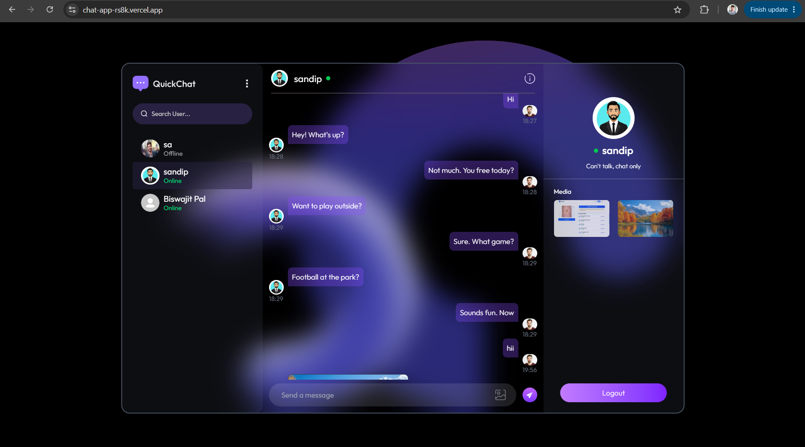
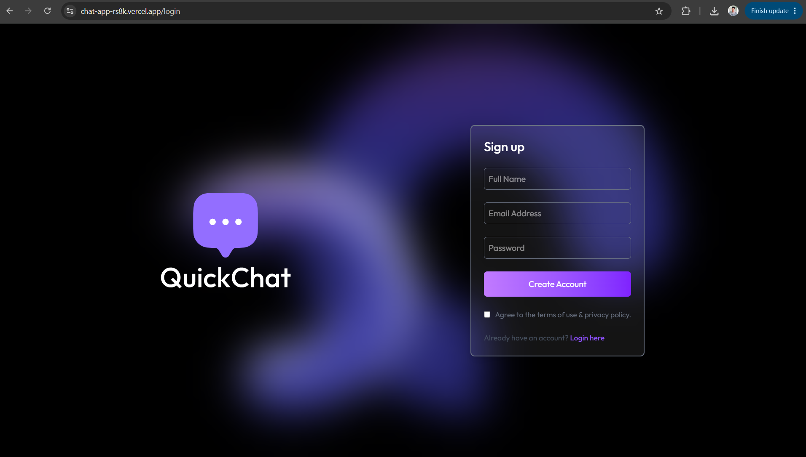
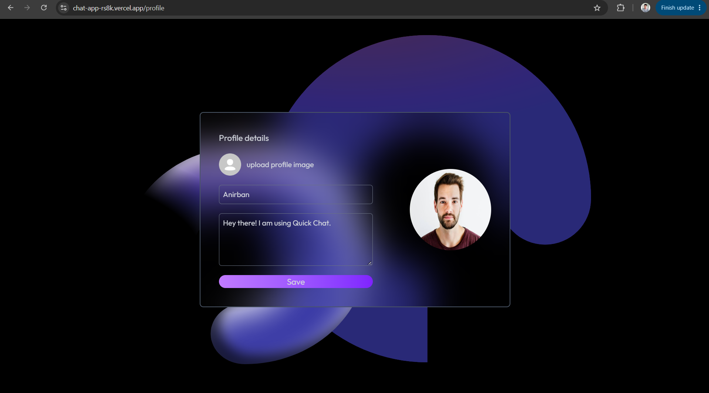

# QuickChat --- Real-Time Chat Application

QuickChat is a full-stack, real-time messaging application built with
the MERN stack and Socket.IO. Users can create an account, sign in, find
other users, exchange text messages and images, and see online status
updates.

## Live Demo

-   **Live application:** https://chat-app-rs8k.vercel.app/login
-   **GitHub repository:** https://github.com/sandip-pal1/chat-app

> The live demo requires an account. If registration is enabled, create
> an account to try the chat features.

## Application Screenshots

### Home Page



### Sign Up Page



### Profile Page



## Features

-   **Authentication:** Sign up and log in using an email and password.
-   **Real-time messaging:** Send messages and receive new messages
    through Socket.IO without refreshing the page.
-   **Image sharing:** Send images in a conversation.
-   **Online status:** See which users are currently connected.
-   **User search:** Search for users by name.
-   **Message history:** Load previous conversations from the database.
-   **Seen/unseen messages:** Track unread messages and mark messages as
    seen when a conversation is opened.
-   **Profile management:** Update profile details and profile picture.
-   **Responsive interface:** Chat layout designed for desktop and
    smaller screens.
-   **Toast notifications:** Display feedback for common actions and
    errors.

## Technology Stack

### Frontend

-   React
-   Vite
-   Tailwind CSS
-   React Router
-   Axios
-   Socket.IO Client
-   React Hot Toast

### Backend

-   Node.js
-   Express
-   MongoDB
-   Mongoose
-   Socket.IO
-   JSON Web Tokens (JWT)
-   bcryptjs
-   Cloudinary for image uploads

### Deployment

-   Vercel for the deployed frontend and backend
-   MongoDB Atlas or another MongoDB deployment for the database
-   Cloudinary for image storage

## How It Works

1.  A user signs up or logs in through the React frontend.
2.  The backend validates credentials and returns a JWT.
3.  The frontend sends the JWT with protected API requests.
4.  The frontend establishes a Socket.IO connection and identifies the
    connected user.
5.  When a message is sent, the backend stores it in MongoDB.
6.  If the recipient is connected, the backend emits the new message to
    that user's Socket.IO connection.
7.  The recipient's interface updates without a page refresh.

## Project Structure

``` text
chat-app/
├── client/
│   ├── context/
│   ├── public/
│   ├── src/
│   ├── package.json
│   └── .env                 # local only; do not commit
├── server/
│   ├── controllers/
│   ├── lib/
│   ├── middleware/
│   ├── models/
│   ├── routes/
│   ├── package.json
│   ├── server.js
│   └── .env                 # local only; do not commit
└── .gitignore
```

## Run Locally

### Prerequisites

-   Node.js and npm
-   A MongoDB database (for example, MongoDB Atlas)
-   A Cloudinary account if you want image uploads to work

### 1. Clone the repository

``` bash
git clone https://github.com/sandip-pal1/chat-app.git
cd chat-app
```

### 2. Configure the backend

``` bash
cd server
npm install
```

Create a `server/.env` file with your own values:

``` env
MONGODB_URI=your_mongodb_connection_string
JWT_SECRET=replace_with_a_long_random_secret
CLOUDINARY_CLOUD_NAME=your_cloudinary_cloud_name
CLOUDINARY_API_KEY=your_cloudinary_api_key
CLOUDINARY_API_SECRET=your_cloudinary_api_secret
```

Start the backend:

``` bash
npm run server
```

The backend development script runs the server with Nodemon. The default
local port is `5000`.

### 3. Configure the frontend

Open a second terminal:

``` bash
cd client
npm install
```

Create a `client/.env` file:

``` env
VITE_BACKEND_URL=http://localhost:5000
```

Start the frontend:

``` bash
npm run dev
```

Open the local URL printed by Vite in the terminal.

> **Important:** Use your own credentials in local environment files.
> Never commit `.env` files or place private server credentials in
> frontend variables. Variables prefixed with `VITE_` are exposed to the
> browser and should not contain secrets.

## Main API Routes

The backend exposes these routes:

  Method   Endpoint                     Purpose
  -------- ---------------------------- --------------------------------------
  `POST`   `/api/auth/signup`           Create an account
  `POST`   `/api/auth/login`            Log in
  `GET`    `/api/auth/check`            Check the current authenticated user
  `PUT`    `/api/auth/update-profile`   Update profile information
  `GET`    `/api/messages/users`        Get users for the sidebar
  `GET`    `/api/messages/:id`          Get messages with a selected user
  `POST`   `/api/messages/send/:id`     Send a message to a user
  `PUT`    `/api/messages/mark/:id`     Mark a message as seen

Protected endpoints require the authentication token expected by the
backend.

## Environment Variables in Vercel

For deployment, configure the required environment variables in the
relevant Vercel project settings rather than committing `.env` files.

**Frontend project** - `VITE_BACKEND_URL` --- the deployed backend base
URL, for example `https://your-backend.vercel.app`

**Backend project** - `MONGODB_URI` - `JWT_SECRET` -
`CLOUDINARY_CLOUD_NAME` - `CLOUDINARY_API_KEY` - `CLOUDINARY_API_SECRET`

Use the actual variable names referenced by your backend configuration.
After changing environment variables, redeploy the relevant Vercel
project if necessary.

## Security Notes

-   Keep `.env` files out of Git.
-   Never publish database passwords, JWT secrets, or Cloudinary API
    secrets.
-   Treat any credential that was previously committed to a repository
    as potentially exposed; rotate it if necessary.
-   Do not store private credentials in `VITE_` frontend variables.

## Future Improvements

-   Add automated tests for authentication, messaging, and socket
    events.
-   Improve delivery/read receipts and reconnect handling.
-   Add pagination for long conversations.
-   Add stronger production validation, rate limiting, and structured
    logging.

## Author

**Sandip Pal**

-   GitHub: https://github.com/sandip-pal1
-   Project repository: https://github.com/sandip-pal1/chat-app
-   Live application: https://chat-app-rs8k.vercel.app/login
